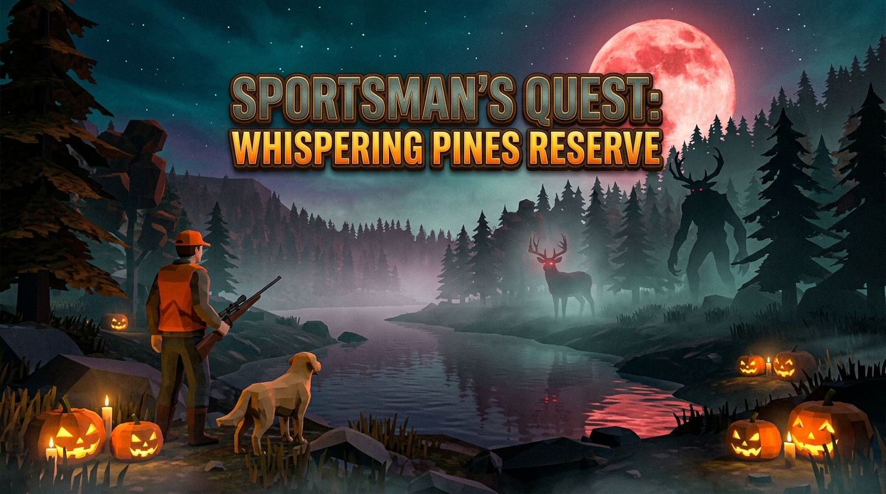
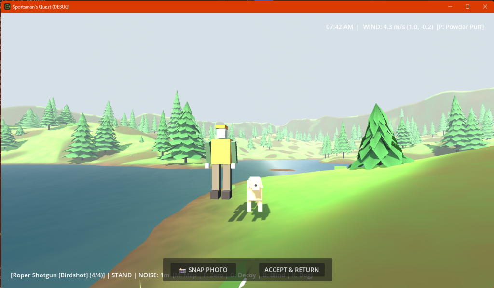

# Sportsman's Quest

**A procedural 3D stalking sim on Whispering Pines: stay downwind, stay quiet, and walk the harvest back to the lodge.**

By [Robert Fernandez](https://robertfernandez.dev) ([robfernan](https://github.com/robfernan)). Godot 4.7. Offline. One playable reserve.





The wide image is key art. The second image is a capture from the Godot scene.

## Play

The published build is [v1.0.0](https://github.com/robfernan/sportsmans-quest/releases/tag/v1.0.0) (28 Oct 2026). The same game is listed on [itch.io](https://mungdaal321.itch.io/sportsman-quest) as "Sportsman Quest" by MungDaal321.

**Windows.** Download `SportsmansQuest_Windows_ReadyToPlay.zip` (91,742,442 bytes). It contains `SportsmansQuest.exe` (180,858,888 bytes) and `SportsmansQuest.pck` (4,204,144 bytes). Unzip and run `SportsmansQuest.exe`.

**Browser.** Download `SportsmansQuest_Web.zip` (18,599,295 bytes). Unzip it and serve the folder. `index.html` loads `godot.js`, `godot.wasm`, and `godot.pck` from that directory.

```bash
unzip SportsmansQuest_Web.zip -d sportsmans-quest-web
cd sportsmans-quest-web
python -m http.server 8080
```

Open `http://localhost:8080`. The pack inside both release zips is a Godot **4.2.2** `GDPC` file. This repository targets Godot **4.7**.

**From source.** Install [Godot 4.7](https://godotengine.org/download/) (the pack in `dist/` was exported with 4.7.2) and run:

```bash
godot --path .
```

The main scene is `scenes/main_menu.tscn`.

| Menu entry | What it does |
| --- | --- |
| Day Hunt Expedition | Loads `scenes/main.tscn` at dawn (06:00). |
| Night Hunt | Same scene, clock set to 10:30 PM, with two extra cryptids. |
| Trophy Lodge | Loads `scenes/trophy_lodge.tscn`. |
| Reserve, Settings | Rewrite the subtitle line. |
| Quit | Closes the game. |

`dist/SportsmansQuest_Compressed.exe` (70,573,064 bytes, Windows PE32+ x86-64) sits next to `dist/SportsmansQuest.pck`. `dist/launch_game.ps1` starts `SportsmansQuest.exe`, and `.gitignore` excludes that filename. Use the release zip or the Godot editor for a known-good launch.

The Windows and macOS export presets record product version `1.0.0`, matching the git tag. This tree is not a new tagged release.

## On the reserve

Whispering Pines is a 600 m noise terrain and a lake (`Terrain.SIZE` in `src/world/terrain.gd`). Pines, animals, and gunshots are built in code. A search of this tree finds no `.gltf`, `.glb`, `.ogg`, `.wav`, or `.mp3` files. The only raster images are the two pictures above.

You hunt in first person. Deer, foxes, and ducks react to scent on the wind, to footstep noise, and to line of sight. Noise radii on the hunter are sprint 75 m, walk 28 m, crouch 9 m, and prone 2.5 m. Rifle shots go through `Ballistics.simulate_shot`: drag, drop, crosswind, and a zero of 100 m, 200 m, or 300 m. The Roper shotgun is a 4-round cylinder. `T` cycles birdshot, 00 buck, and rifled slug. `R` reloads.

`G` places a floating mallard decoy. `B` pitches a reed blind. `E` boards the kayak, climbs a stand, and harvests a downed animal. Hold `Q` or `Tab` for a gear wheel with the rifle, shotgun, binoculars, deer call, and duck call. Wind powder is `6` or `P`, then left click.

`K` tells the retriever to heel, stay, work a nearby blood trail, or retrieve a downed mallard that is still on the water. The dog brings the bird back and the harvest card opens.

A harvest opens a third-person photo pose. Trophies are written to `user://sportsmans_quest_save.json`.

Spawn lists in `src/world/game_world.gd` place 32 whitetail (six herds of four, plus eight solitary bucks), 14 red foxes, 14 mallards, and 25 jack-o'-lanterns. A ghost buck, a werewolf, and a wendigo are present on day and night hunts. Night Hunt adds a second ghost buck and a second werewolf.

## Controls

| Input | Action |
| --- | --- |
| `W` `A` `S` `D` | Walk. In the kayak, `W` / `S` paddle and `A` / `D` steer. |
| `Shift` | Sprint |
| `C` | Crouch from stand or prone. Stand if already crouched. |
| `Z` | Prone from stand or crouch. Stand if already prone. |
| `Space` | Jump while standing on the ground |
| Mouse | Look |
| Right click | Aim |
| Left click | Fire, call, or puff powder, whichever is in hand |
| `1`–`5` | Rifle, shotgun, binoculars, deer call, duck call |
| `6` or `P` | Equip wind powder |
| `T` / `R` | Cycle shotgun shell / reload |
| `F` | Rifle zero: 100 m, then 200 m, then 300 m |
| `M` | Huntermate map |
| `G` / `B` | Duck decoy / reed blind |
| `K` | Dog: heel, stay, blood trail, or retrieve a downed mallard |
| `Q` or `Tab` (hold) | Gear wheel |
| `E` | Interact |
| `Esc` | Pause. The reserve stops. Esc again resumes. |
| Backtick or `F10` | Return to the main menu |

## Audio

Cues are procedural mono PCM from `src/core/audio_synth.gd` (22050 Hz, no sample bank). `default_bus_layout.tres` is the shared Web and Desktop mix: Master at 0 dB with a limiter ceiling of −1 dBTP, Music −12 dB, Ambience −16 dB, SFX −6 dB, UI −10 dB. Wind, daylight bird chirps, and the trophy-lodge room go to Ambience. Guns, footsteps, fabric, calls, animals, paddle strokes, and impact stings go to SFX. The shared click (reload, zero, equip, dry fire) and the harvest sting go to UI. Predator damage is a thud plus a short grunt, not that click. There is no music stem yet; that bus is reserved.

`AudioDirector` keeps Master muted until the first click, key, touch, or gamepad button, then resumes the Web Audio context if the browser had blocked autoplay. Leaving the window, or hiding the browser tab, mutes Music and Ambience and restores them on return. SFX and UI stay up.

Footsteps (four takes per surface), clothing rustle (three takes), rifle echo tails, bird chirps, paddle strokes, and the short horror and harvest stings are built once and reused. Stance changes footstep level, and each play nudges pitch, so those cues are not resynthesized on every step.

Daylight plays a chirp on a timer. A living werewolf or wendigo within 80 m hushes the birds. The ghost buck plays its chime once when it comes within 80 m. Aiming ducks the wind by 3 dB and, unless `enable_aim_breathing` is turned off on the hunter, plays a light breath loop at −22 dB. The lodge room tone and hearth crackle are synthesized loops in `room_tone()` and `fire_crackle()` (`enable_fire_crackle` turns the hearth off). Nothing in this mix loads an `.ogg`, `.wav`, or `.mp3`.

`tools/audio_mix_check.gd` checks those bus levels, the −1 dB ceiling, and that the pools are reused:

```bash
godot --headless --path . --script res://tools/audio_mix_check.gd
```

## Build

Stay on **Godot 4.7 stable**. Do not open this project in 4.8 or later. `project.godot` feature tag is `4.7`. Presets in `export_presets.cfg` leave `custom_template/debug` and `custom_template/release` empty so Godot uses the templates installed for that editor. There is no machine-local template path.

Install the export templates that match the editor patch, for example `4.7.2.stable`:

| OS | Template folder |
| --- | --- |
| Windows | `%APPDATA%\Godot\export_templates\4.7.2.stable\` |
| Linux | `~/.local/share/godot/export_templates/4.7.2.stable/` |
| macOS | `~/Library/Application Support/Godot/export_templates/4.7.2.stable/` |

Editor: Manage Export Templates, or unzip `Godot_v4.7.2-stable_export_templates.tpz` into that folder. Set `GODOT` to the 4.7 editor binary if it is not on `PATH`.

```bash
# Smoke the menu, then the reserve. No templates required.
godot --headless --path . --quit-after 2
godot --headless --path . res://scenes/main.tscn --quit-after 3

# Pack only (no export templates). Proves the preset loads.
python tools/export_release.py pack windows
python tools/export_release.py pack linux
python tools/export_release.py pack macos
python tools/export_release.py pack web

# Release binaries. Requires the matching 4.7 templates.
python tools/export_release.py windows   # dist/SportsmansQuest.exe (pck embedded)
python tools/export_release.py linux     # dist/linux/SportsmansQuest.x86_64
python tools/export_release.py macos     # dist/macos/SportsmansQuest.zip
python tools/export_release.py web       # dist/web/index.html
python tools/package_windows.py          # dist/SportsmansQuest_Windows_ReadyToPlay.zip
```

`tools/build_web.py` is the web target. Serve `dist/web/` and open the root. Do not open `index.html` as a file URL.

```bash
cd dist/web
python -m http.server 8080
```

### Device matrix

| Target | Preset | Output | This repo |
| --- | --- | --- | --- |
| Windows | Windows Desktop (Ultra-Lite) | `dist/SportsmansQuest.exe` | Preset documented. Release export needs the Windows template. |
| Linux | Linux Desktop | `dist/linux/SportsmansQuest.x86_64` | Preset documented. x86_64, pck embedded. |
| macOS | macOS Desktop | `dist/macos/SportsmansQuest.zip` | Preset documented. Universal binary, ad-hoc signature (`codesign/codesign=1`), notarization off. Gatekeeper will warn. Not built on Linux CI. |
| Web | Web | `dist/web/index.html` | Preset documented. `thread_support=false`, `extensions_support=false`, empty custom template, so Godot picks `web_nothreads_release.zip`. |
| Android | none | — | Blocked. `Mobile` in `config/features` is the compatibility renderer tag, not a touch build. The input map is keyboard and mouse. No Android preset. |

Web caveats:

- **Nothreads.** Itch and plain `python -m http.server` do not send COOP/COEP. The nothreads template is the one that runs there. Do not flip `variant/thread_support` on without those headers.
- **Audio focus.** Browsers block audio until a gesture. Menu wind starts on the first click or key. Click the canvas if the reserve is silent.
- **Memory.** The reserve builds terrain, herds, and synth WAVs in RAM. Footsteps are cached. A desktop browser is the target. Mobile browsers are not a supported port.
- **Pointer lock.** Click the game after load. Esc pauses and releases the mouse.

These rebuilds do not replace the live itch page.

## Art handoff

Hand to Game Art Director. This pass does not invent a palette or new sprites.

Support-only flags for Whispering Pines: pine teal, blaze vest, blood-moon / cryptid eye, first-person camera, and brass UI shared with Hopeless Catch. Wind and scent stay brass and haze on the existing top label. They are not a radar.

Blocked-art fallbacks already in code:

- Distant animals pick up a dark fog silhouette in `src/animals/animal.gd` (`_update_fog_silhouette`). Close animals keep their block meshes.
- Blood trail is `#8B1E1E` in `src/world/track_manager.gd` and the ground decal in `src/animals/animal.gd`. Lung hit spray is that color, not pink.
- Bird marks on the paper map in `src/ui/map_canvas_drawer.gd` are brass dots. The cyan radar blip is gone.

Gaps, with the paths that own them:

| Gap | Where | If art replaces it |
| --- | --- | --- |
| First-person arms and blaze vest | Hunt camera is `Head/Camera3D` in `src/player/hunter.tscn`. Vest color exists only on the photo rig in `src/player/hunter_third_person_builder.gd` (`Color(0.88, 0.40, 0.08)`). | FP arms mesh. A 1024 vest/jacket sheet if the photo rig is replaced. |
| Pine teal | `src/world/tree_builder.gd` leaf `Color(0.16, 0.28, 0.18)`, bark `Color(0.24, 0.16, 0.10)`. No needle texture. | Foliage mesh or atlas. `src/world/foliage.gdshader` has a tint uniform and no sampler. |
| Cryptid eyes | Box meshes: `src/animals/werewolf.gd`, `src/animals/wendigo.gd`, `src/animals/ghost_buck.gd`. | Blood-moon eye treatment on those meshes. No new creature design in code. |
| Water normal | `src/world/water.gdshader` uses the vertex wave. Nothing assigned a normal map. | `res://assets/water_normal.png`, 512×512, then a sampler in that shader. |
| Terrain albedo | `src/world/terrain.gdshader` has no texture slot. | Adding one means a new `sampler2D` plus a 2048 map. |
| Icon | `res://icon.svg` only. | 256 and 512 PNG. macOS export also accepts `.icns`. |
| Audio | `src/core/audio_synth.gd` only. No `.ogg` / `.wav` / `.mp3`. | Stay procedural. Do not add a sample bank. |

The hunt camera stays first person. Third person is the harvest photo pose only.

## Size

These are file sizes, counted from this tree and from the v1.0.0 release archives.

| What | Bytes |
| --- | ---: |
| Every `.gd`, `.gdshader`, `.tscn`, and `project.godot` file (59 files) | 335,608 |
| `dist/SportsmansQuest.pck` (Godot 4.7.2 pack in the repo) | 1,826,512 |
| `dist/SportsmansQuest_Compressed.exe` | 70,573,064 |
| `media_banner.jpg` / `media_screenshot.png` | 894,679 / 776,124 |
| v1.0.0 `SportsmansQuest_Windows_ReadyToPlay.zip` | 91,742,442 |
| v1.0.0 `SportsmansQuest.exe` inside that zip | 180,858,888 |
| v1.0.0 `SportsmansQuest.pck` inside that zip (Godot 4.2.2) | 4,204,144 |
| v1.0.0 `SportsmansQuest_Web.zip` | 18,599,295 |
| `godot.wasm` inside the web zip | 39,514,754 |

The 335,608 byte figure is the sum of those 59 source files, skipping `.git`. That source total is under 1 MB. Runnable builds are the pack, the executables, and the release zips in the rows under it.

Pack versions are the major, minor, and patch integers in the `GDPC` header (format version 4, then `4, 7, 2` for the repo pack and `4, 2, 2` for the release pack). The repo pack's path table includes `res://media_banner.jpg` and `res://media_screenshot.png` plus compiled scripts. Release byte counts are the zip central directory (`unzip -l` on the v1.0.0 assets).

## Star

If you want this reserve to keep growing, star [robfernan/sportsmans-quest](https://github.com/robfernan/sportsmans-quest).

## License

`export_presets.cfg` and `SPORTSMANS_QUEST_OUTLINE.md` name the MIT License. This repository has no `LICENSE` file.
